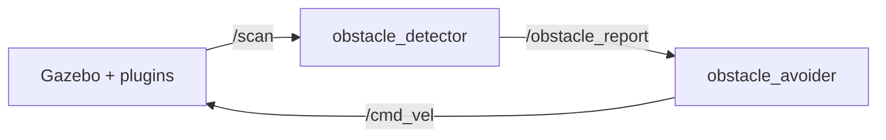

# Development of a Virtual Autonomous Robot using ROS2 and Gazebo

**Autonomous obstacle detection and avoiding robot** — Ubuntu Linux with **ROS 2** and **Gazebo** integrated for simulation and control.

This repository implements the full concept: install Ubuntu/Linux, integrate ROS 2 and Gazebo, spawn a virtual differential-drive robot with lidar, detect obstacles, and autonomously avoid them in simulation.

The stack includes:

- URDF robot model with diff-drive plugin and 360° lidar
- Gazebo world with walls, boxes, and cylinders
- **Obstacle detector** node (lidar → sector ranges + `ObstacleReport`)
- **Obstacle avoider** node (reactive turn / reverse / forward policy)
- Docker-based Ubuntu desktop + noVNC (works on macOS via `linux/amd64`)

## Architecture



## Prerequisites

- [Docker Desktop](https://www.docker.com/products/docker-desktop/) (Apple Silicon Macs run the sim under `linux/amd64`)
- ~8 GB free disk for the ROS desktop image

## Quick start

```bash
cd virtual-autonomous-robot
docker compose up --build
```

Open **http://127.0.0.1:6080/** (password: `ubuntu`).

Inside the desktop **Terminator** terminal:

```bash
source /home/ubuntu/workspace/install/setup.bash
ros2 launch virtual_robot_bringup bringup.launch.py
```

You should see Gazebo, the blue robot in the obstacle arena, green lidar rays, and the robot driving while steering around obstacles.

### Useful topics

| Topic | Type | Purpose |
|-------|------|---------|
| `/scan` | `sensor_msgs/LaserScan` | Raw lidar |
| `/obstacle_report` | `virtual_robot_msgs/ObstacleReport` | Front/left/right clearance |
| `/cmd_vel` | `geometry_msgs/Twist` | Motor commands |
| `/avoidance_action` | `std_msgs/String` | Current behaviour label |
| `/odom` | `nav_msgs/Odometry` | Wheel odometry |

```bash
ros2 topic echo /avoidance_action
ros2 topic hz /scan
```

## Build and test (host scripts)

```bash
chmod +x scripts/*.sh
./scripts/build.sh
./scripts/test.sh
```

## Packages

| Package | Role |
|---------|------|
| `virtual_robot_description` | URDF/Xacro, Gazebo world |
| `virtual_robot_msgs` | `ObstacleReport` message |
| `obstacle_avoidance` | Detector + avoider nodes + policy |
| `virtual_robot_bringup` | Launch files |

## Native Ubuntu install (optional)

On **Ubuntu 22.04**:

```bash
sudo apt update
sudo apt install -y ros-humble-desktop ros-humble-gazebo-ros-pkgs ros-humble-xacro python3-colcon-common-extensions
source /opt/ros/humble/setup.bash
cd virtual-autonomous-robot
colcon build --symlink-install
source install/setup.bash
ros2 launch virtual_robot_bringup bringup.launch.py
```

## 3-day project plan

| Day | Focus |
|-----|--------|
| **1** | Ubuntu + ROS 2 + Gazebo setup; URDF, world, spawn robot; verify `/scan` and `/cmd_vel` |
| **2** | Obstacle detector; `ObstacleReport`; tune sector thresholds; demo detection in Gazebo |
| **3** | Avoidance policy; full bringup launch; record demo video; report (architecture, tests, results) |

## Presentation (graphs for invigilator)

See **[docs/PRESENTATION.md](docs/PRESENTATION.md)**.

- **Live:** `rqt_plot` on `/obstacle_report/*` and `/cmd_vel/*`
- **Saved PNGs:** while sim runs, `ros2 run obstacle_avoidance plot_logger` → `docs/graphs/*.png`

## Troubleshooting

- **Blank Gazebo window in Docker**: compose already sets `seccomp=unconfined` and `shm_size=512m`. Restart the container.
- **Robot does not move**: wait ~5 s after launch (nodes start on a timer after spawn). Check `ros2 topic echo /cmd_vel`.
- **Build errors on Mac**: ensure `platform: linux/amd64` in `docker-compose.yml` (Gazebo packages are amd64-only in this image).

## License

MIT
